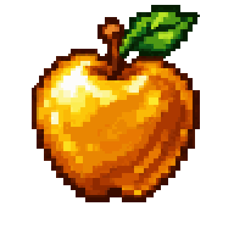

<p align="center">
  
</p>

<h1 align="center">SmugVTT</h1>

<p align="center">
  <strong>Three Pillars. One Tabletop.</strong><br>
  <em>A VTT should adapt to the way people play.</em>
</p>

<p align="center">
  <a href="#why-smugvtt">Why SmugVTT?</a> ·
  <a href="#what-makes-smugvtt-different">Features</a> ·
  <a href="#development-roadmap">Roadmap</a> ·
  <a href="#getting-started">Install</a> ·
  <a href="#credits-and-license">Credits</a>
</p>

---

## Why SmugVTT?

**SmugVTT** is an independently maintained, self-hosted fork of [CozyVTT](https://github.com/CheekyChinchilla/CozyVTT). It explores a different approach to virtual tabletop design: let the group choose whether a session revolves around a tactical map, in-character conversation, or arranging visual material, rather than forcing every campaign into the same interface.

**Three Pillars. One Tabletop.**

| Pillar | Purpose |
| :--- | :--- |
| **Map** | A spacious, interactive battlefield and exploration workspace. |
| **Chat** | A first-class place for conversation, character portrayal, and dice. |
| **Canvas** | A free-form visual workspace for staging, images, handouts, and ideas. |

A **Scene** workflow connects character portraits and in-character dialogue with the other workspaces. Optional game-system tools should enhance play without becoming mandatory for every campaign.

SmugVTT is a **solo-maintained, independent project**, not an official CozyVTT release. Its inherited engine and much of its functionality are CozyVTT's work. The features described below distinguish the fork's *development direction and additions*, not a claim to have invented maps, chat, dice, character sheets, or other upstream features.

## Release status: public repository vs. local development

> **Important (November 2026):** The public `main` branch is a **foundation snapshot** with SmugVTT branding and documentation. Many of the additions below have been developed as **local patch builds**, but **have not yet been committed and released in this GitHub repository**. Cloning `main` does **not** currently install the full feature set described under local development. The roadmap is not a promise of completed features or release dates.

| Status | What it means |
| :--- | :--- |
| **Public foundation** | Available from this GitHub repository's default branch. |
| **Local development** | Implemented or prototyped in local SmugVTT builds; public source and integration testing are still pending. |
| **Planned** | Design or implementation work remains; not available as a release. |

## What makes SmugVTT different?

### What is currently on public `main`

The public foundation has the original CozyVTT functionality, SmugVTT-specific configuration and documentation, and privacy-safe **Squad Command** learning samples. A logo, color theme, and project name establish identity, but are **not** themselves gameplay features or reasons to choose this fork.

**Most SmugVTT gameplay additions are still in local development builds pending source integration and release checks.** They are detailed below so visitors can follow the work without mistaking it for a published download.

### Built or prototyped in local development builds — not yet on public `main`

These items describe work developed in the local fork. Individual features may still have bugs, incomplete permissions, or pending regression tests.

#### Flexible Map, Chat, and Canvas layout

- **Full-bleed map workspace** with panels intended to dock or overlay without unnecessarily shrinking the play area.
- **Three-pillar interface experiments:** more flexible access to Chat, Journal/handouts, Media Library, and Dice.
- **Token interaction refinements:** click to select, click-drag-release to move, keyboard nudging, and clearer selection/deletion behavior.
- **Map-focused quick access:** compact token details and action panels intended to reduce constant switching between character sheets.

#### Roleplay-first chat and Scenes

- **Character-focused conversation:** speaker presentation, portraits, presence, and typing indicators.
- **In-character dialogue tools:** quoted lines and portrait-based speech bubbles for staged interactions.
- **Scene staging:** a dedicated space for arranging participants and connecting roleplay to Map and Canvas.
- **Chat usability improvements:** integrated dice-command workflow and work on consistent message persistence and deletion.
- **Portrait and media presentation** refined for narrative sessions as well as encounters.

#### Canvas and shared visual material

- **Free-form Canvas work** for placing and organizing images and other scene material.
- **Scene/Canvas integration experiments** for shared staging and portrait presentation.
- **Media and handout workflow refinements** to support sessions that do not center on a battlemap.

#### Optional combat and unit-management tools

These local tools are being generalized as **Squad Command**, an **optional** combat/unit-management module, not a required ruleset. The public repository currently contains [privacy-safe example templates and the integration checklist](Examples/SquadCommand/README.md), **not the working module**.

- **Unified combat HUD:** quick access to health, defense, shields, suppression, and relevant active conditions.
- **Token targeting and feedback:** target selection, range assistance, readable hover information, and condition markers.
- **Reusable unit templates and sheetless spawns:** place temporary combat units directly on maps without filling the permanent character roster.
- **Legacy-unit cleanup tooling:** guarded identification and preview of older sheet-backed spawns, with backup-conscious cleanup procedures.
- **Combat action refinements:** special-action UI, animated targeting feedback, activation controls, and synchronization between map tokens and character sheets.

Some of these systems are only partially verified in the live installation. In particular, cleanup of ambiguous older records and recent combat-status/chat fixes are still subject to regression testing.

### Battlefield Overlay Toolkit — local development (v0.8.4 series)

A new GM toolkit for visual and tactical map annotations, designed to work without forcing a particular ruleset:

- **Color-coded zones** for light/heavy cover, high/low ground, smoke, obscuration, healing, and hazards.
- **Editable shapes:** draw, select, move, resize, duplicate, recolor, and remove rectangles, ellipses, and polygons, with adjustable transparency.
- **Visible textures and explanations:** hatched/dotted fills and mouseover plates describing each area.
- **Per-player artwork visibility controls:** hide visible overlay artwork without disabling the gameplay effect or exposing GM-only information.
- **Positional effects:** token containment detection; cover affects applicable sheetless Squad Command attacks, while smoke and elevation use existing modifiers where supported.
- **One-shot healing AoE:** GM reviews highlighted eligible targets and explicitly approves or declines a single healing activation. No healing over time, automatic repeat trigger, or repeated entry healing.
- **Token status feedback:** active conditions, cover, Rally/Eager/Relentless readiness, and other tracked traits are being surfaced in compact token badges and hover details.

*Development verification:* Zone creation/editing, Light/Heavy Cover effects, improved textures, and cover hover labels have received local user confirmation. More recent targeting, status, dialogue-panel, and combat fixes are still pending a coordinated public build and regression pass. The full toolkit is **not yet on this repository's default branch**.

### Safety, backwards compatibility, and game-system separation

The generic Map/Chat/Canvas/Scene work is intended to serve **any RPG system**. Squad Command is an optional rules module: its combat mechanics, unit templates, and status tracking should not be imposed on other systems. The public module will contain **two learning units and two learning weapons** rather than an exported private campaign roster. Existing user-created characters and tokens must remain intact through upgrades.

## Development roadmap

These are *plans*, not features in the public download.

| Pass | Focus | Status |
| :--- | :--- | :--- |
| **v0.8.3 — Combat reliability** | Finish status indicators and hover cards; verify sheetless-unit state synchronization, action restrictions, Overwatch/Rally behavior, and turn controls. | **In progress locally** |
| **v0.8.4 — Battlefield zones** | Colored overlays, editable zones, textured fills, player artwork toggle, positional effects, and one-shot GM-confirmed healing; further hex-grid work remains separate. | **Developed locally; integration/testing pending** |
| **v0.8.5 — Scene and Canvas polish** | Shared staging, quoted in-character dialogue, portrait speech bubbles, persistence, and permission/regression testing. | **Tentative** |
| **Public release preparation** | Integrate reviewed local changes, run tests, document compatibility and migrations, and publish source/release notes. | **Required before release** |

Beyond individual passes, the goal is a **customizable, system-agnostic core** with optional specialized modules, legible GM controls, and a workflow that accommodates theater-of-the-mind, narrative, and tactical play alike.

## Getting started

SmugVTT is self-hosted. The public repository uses Docker Compose. A manual install requires **Node.js 26+** (Docker supplies its own Node.js runtime).

- Node.js 26+

Install Docker, Git, and a modern browser, then clone the **public foundation**:

```bash
git clone https://github.com/Huemaster/SmugVTT.git
cd SmugVTT
cp .env.example .env
```

On Windows PowerShell, replace the final command with `Copy-Item .env.example .env`.

Set unique `DATABASE_PASSWORD` and `SESSION_SECRET` values in `.env`. The session secret must be at least 32 random characters; for example:

```bash
openssl rand -hex 16  # database password
openssl rand -hex 32  # session secret
```

Start the application:

```bash
docker compose up -d --build
docker compose logs backend
```

Open **http://localhost** and follow initial setup. The backend logs provide the one-time setup token.

**Before exposing your instance to the internet**, read the [Deployment Guide](docs/DEPLOYMENT.md) for HTTPS, `CORS_ORIGIN`, proxies, account security, and backups. Never commit `.env` files, private campaigns, chat logs, character records, or database exports.

The Compose stack applies `no-new-privileges` and drops every Linux capability except the few its start-up needs. The nginx master process runs as root so it can bind the published ports and start workers under the nginx user; the backend switches to its unprivileged `appuser` before starting the application.

### Updating an installation

SmugVTT does not automatically incorporate every upstream CozyVTT release. Upstream or local changes may affect schemas and saved data. Back up your installation and test important material on a disposable copy before updating.

**Local patch ZIPs discussed during development are not part of a fresh GitHub clone** unless their changes have subsequently been integrated and released.

## Documentation

- [Deployment Guide](docs/DEPLOYMENT.md) — hosting, configuration, hardening, and backups
- [User Guide](docs/USER_GUIDE.md) — existing application functionality
- [Development Guide](docs/DEVELOPMENT.md) — building and testing
- [Branding Guide](docs/BRANDING.md) — SmugVTT's visual identity
- [Contributing](docs/CONTRIBUTING.md) — contributions and issue reports
- [Security Policy](SECURITY.md) — private vulnerability reporting

Focused bug reports and proposed improvements are welcome. Please use **fictional examples** and do not submit private character records, campaign material, credentials, or personal data.

## Documentation policy

**Every new SmugVTT-specific user-facing feature must be documented in this README and the changelog when its source is integrated.** Feature descriptions must distinguish available public releases from local prototypes and future plans. Branding updates alone are not gameplay features.

## Credits and license

SmugVTT is based on **[CozyVTT](https://github.com/CheekyChinchilla/CozyVTT)**. The original maintainers and contributors deserve full credit for the project's foundation and inherited functionality. SmugVTT is independent and is **not endorsed by CozyVTT**.

The source remains licensed under the [GNU Affero General Public License v3.0](LICENSE). Original copyright notices and applicable third-party attributions are retained:

- [Third-party licenses](THIRD_PARTY_LICENSES.md)
- [Third-party notices](THIRD_PARTY_NOTICES.txt)
- [SRD attribution](SRD_ATTRIBUTION.md)
